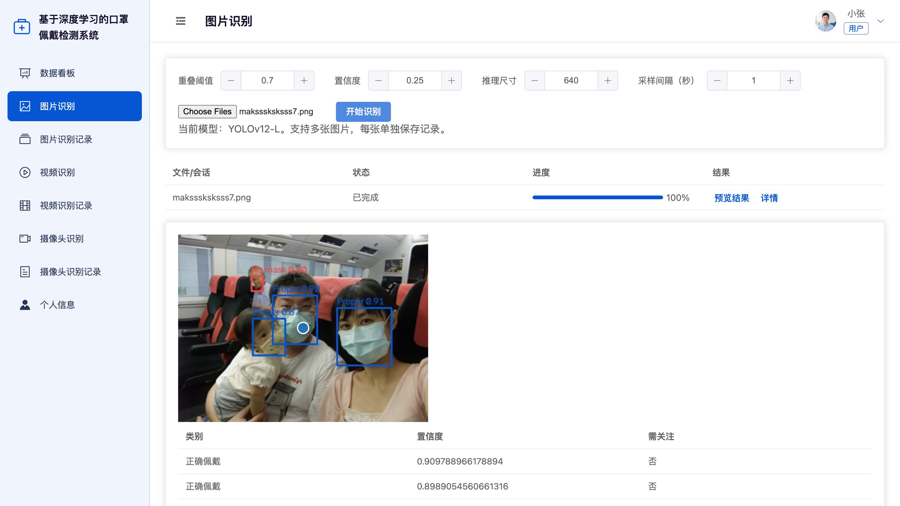
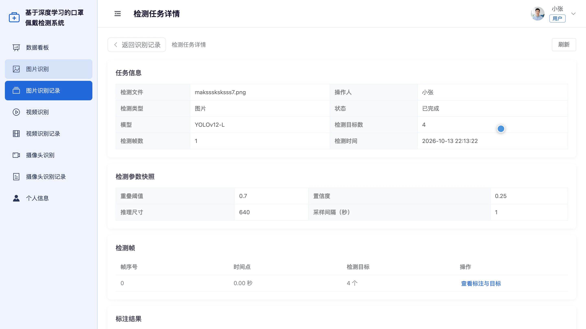
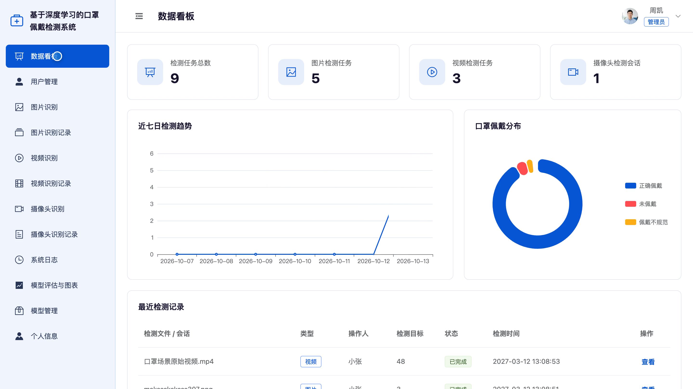
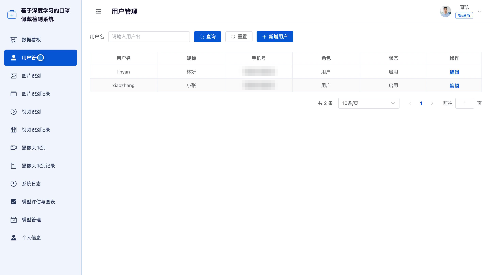
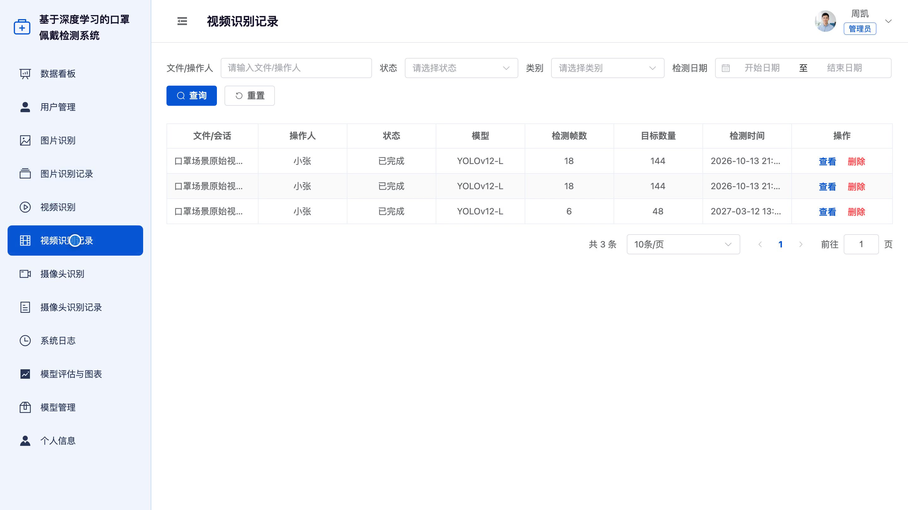
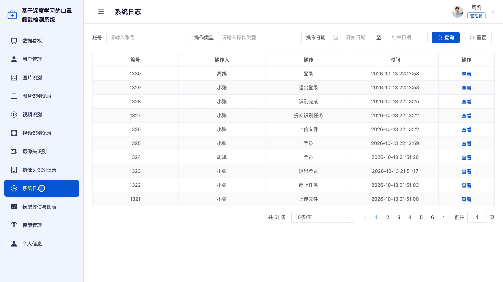
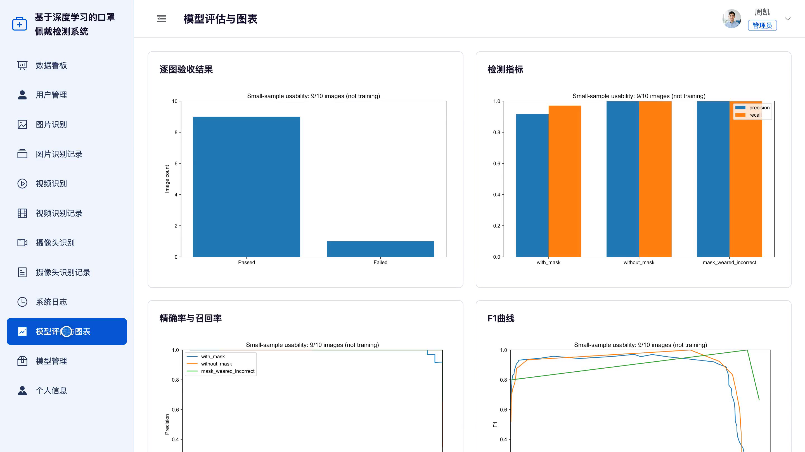

## 源码问题查看主页咨询

### 一、关键词
口罩佩戴检测、人脸防护识别、口罩合规检查、公共场所防疫、佩戴规范监测

### 二、作品包含
源码+数据库+全套环境和工具资源+本地部署教程

### 三、项目技术
前端技术： Html、Css、Js、Vue3.4、Element-Plus
后端技术：Python、Django、DRF、Ultralytics、PyTorch、OpenCV、YOLOv12-L

### 四、运行环境要求
开发工具：PyCharm + VSCODE

数据库：MySQL5.7+（共8张表）

数据库管理工具：Navicat10以上版本

环境配置软件： Python3+

前端Nodejs：16+

浏览器：谷歌浏览器

### 五、项目介绍
项目编号：bs164D

本系统面向公共场所口罩佩戴状态检查，支持通过图片、视频和摄像头检测正确佩戴、未佩戴与佩戴不规范三类状态，并结合标注画面、检测记录和统计图查看检测结果。用户可管理本人识别任务，管理员可查看全局统计并维护用户、检测记录和模型。

角色：用户、管理员

用户功能：图片单张与批量识别、视频识别、摄像头识别、本人图片及视频与摄像头记录查询、检测参数与标注结果查看、个人资料及头像与密码维护。

管理员功能：全局检测数据看板、用户与账号状态管理、图片及视频与摄像头识别、全局检测记录与任务参数管理、系统操作日志查询、模型评估图表查看与放大、模型登记与已验证版本切换、个人资料及头像与密码维护。

### 六、运行截图

